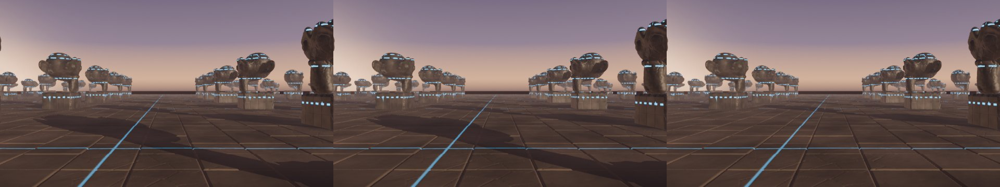

# Native streaming: virtualized geometry rendered by EEVEE and Cycles

VGEO started as a headless Vulkan meshlet renderer whose pixels were copied
into the viewport (removed in November 2026). That could never look like
EEVEE or reach Cycles, because it replaced Blender's renderers instead of
feeding them.

The native streaming path keeps Blender's renderers and virtualizes the
*geometry* instead: a Nanite-style cluster DAG lives on disk and in the
native library, and only the view-dependent cut is handed to Blender as
ordinary meshes. Everything Blender can do with a mesh (materials, lights,
shadows, ray tracing, Cycles, EEVEE) just works, and Blender only ever holds
the triangles the current view needs.

## Pipeline

```
Blender mesh (modifiers applied)
    │  addons/vgeo/build.py: triangles, normals, UVs, materials (indexed when smooth)
    ▼
vgeo_stream.dll: vgeo_build
    │  weld → meshoptimizer clusterlod (group clusters, simplify each group with
    │  its border locked, re-split, repeat) → spatial chunks → .vgeo v2
    ▼
.vgeo file (next to the .blend, in //vgeo/)
    │
    ▼
vgeo_stream.dll: vgeo_select / vgeo_extract          (ctypes, no Python ABI)
    │  per view: pick the crack-free cut, hash each chunk's cluster set,
    │  extract changed chunks as indexed meshes with edges
    ▼
addons/vgeo/stream.py
    │  proxy object + chunk objects (parented to it, in a collection linked next to it)
    │  live loop in the viewport, render_pre handler for final renders
    ▼
EEVEE / Cycles / Workbench
```

## Why the cut never cracks

Each cluster in group `g`, simplified from group `r`, is drawn when
`error(g) > t` and `error(r) <= t` (or it is original geometry). Group bounds
enclose their children's bounds and errors only grow up the DAG, so the
decision is monotonic and neighbouring clusters always agree on the border
they share. The tests weld every cut and count open edges: always zero.

**Off-screen coarsening** (the default) raises the threshold for groups
entirely outside the view. That stays crack-free: a group outside the view
has all its finer groups outside too, so monotonicity holds. Off-screen
geometry is kept at low detail, so it still casts shadows and shows in
reflections.

## Landing updates without hitches

Every chunk is a pair of objects. How an update lands depends on the views:

| Views | Strategy | Why |
|---|---|---|
| Solid, Workbench, EEVEE | **staged**: fill the hidden back (scale 0, no shadows) a few ms per tick, then flip scales | Blender prepares the back's GPU buffers as it fills; the flip is a transform change |
| Cycles Rendered | **settle**: update once the view is still for 0.3 s | Cycles rebuilds its BVH and restarts sampling anyway |

The chunks are ordinary objects parented to the proxy, linked through a
collection next to it. Until September 2026 they were instanced by a
Geometry Nodes modifier on the proxy (Collection Info). That made every chunk
change re-evaluate the proxy, and EEVEE then treated the whole instanced
surface as changed: refilling one hidden back cost ~120 ms per frame, so
EEVEE views landed updates in one batch (unlinked spare meshes swapped in),
which cost 100-300 ms in the landing frame (tests/eevee_land_bench.py):

| EEVEE, 70 chunks / 3.1M triangles, 5.1.2 | Geometry Nodes instancing | Separate objects |
|---|---|---|
| Idle frame | 9.7 ms | 9.6 ms |
| Frames while one hidden back is refilled per tick | 119 ms | 25 ms |
| Landing by swapping mesh data | 119 ms | 192 ms |
| Landing prefilled backs by a scale flip | 43 ms | 28 ms |

The proxy keeps its materials and eight loose points at the asset's bounds
(Frame Selected works; nothing is drawn or rendered). Selection, hiding and
render visibility follow the proxy: clicking the surface selects the proxy,
and hiding the proxy hides the chunk collection. Files made with the old
modifier are switched over when opened; a deleted proxy's chunk collection is
unlinked. The BATCH strategy remains in `stream_step` for scripts.

Lessons measured along the way (tests/viewport_bench.py, tests/swap_bench.py):

- Creating or deleting datablocks, and assigning materials, force a
  depsgraph relations rebuild; mid-stream material assignment made EEVEE
  re-sync the whole scene every frame. Streaming now creates nothing and
  assigns materials up front.
- `foreach_set` takes a per-item path for topology arrays. The add-on copies
  arrays straight into mesh attributes (verified once per session on a fixed
  mesh, falling back to `foreach_set`), and the native library computes
  edges so `mesh.update()` does not. Writes went from 0.9M to 8-10M
  triangles/s.
- Around 512 chunks is the sweet spot: 2048 objects made every frame and
  every relations rebuild slower than the smaller updates saved.

## Measured (RTX A4500 over a remote desktop, Blender 5.1.2)

Terrain demo: 33.5M triangles from Geometry Nodes (`examples/terrain_demo.py`).

| | |
|---|---|
| Build (clusterlod, single thread) | 129-141 s, 19 LOD levels, 512 chunks, 1.2 GB file |
| Cut from the hero camera, 1080p, 1 px, off-screen coarsened | 2.5M triangles (7.4 %) |
| Full rebuild of a 7.7M-triangle cut | 1.3 s |
| Viewport idle, Solid / EEVEE | ~75 / ~55 fps |
| Viewport while continuously streaming, Solid | ~29 fps, worst frame ~45-48 ms |
| Viewport while continuously streaming, EEVEE | ~26 fps, worst frame ~56 ms (was 0.3-0.4 s with Geometry Nodes instancing) |
| Cycles, 1080p, 64 samples, same material: raw 33.5M mesh | 93-118 s |
| Cycles, same frame from the VGEO cut (9.8M triangles, 0.5 px) | 49-51 s |
| Difference between the two images | mean 0.02/255, 99th percentile 1/255 |

## Memory: the file is mapped, not read

`vgeo_open` memory-maps the .vgeo instead of reading it. Opening reads the
header and the cluster, group and chunk tables; geometry pages load when a
cut first touches them, and the OS evicts them under memory pressure, so an
asset larger than RAM can be opened and streamed, and every handle on the
same file (the proxy, instancer level builds, web export, per-placement
cuts) shares one copy of the pages. Indices are validated per cluster on
first use instead of by a scan at open (a bad cluster is skipped and
`vgeo_corrupt` reports it). The per-handle scratch that mapped global vertex
indices to chunk-local ones (8 bytes per vertex of the asset) is now a hash
sized to the chunk. Before extracting, the add-on calls `vgeo_prefetch` for
the changed chunks, which asks the OS to start reading their index and
vertex ranges. The hint runs on a background thread per handle (the OS call
can block for seconds when pages are cold: done inline it produced 2-3 s
frames), and vertex ranges of clusters whose vertices span most of the file
are skipped.

Terrain asset (1.2 GB, 33.5M triangles), two handles, plain Python
(`tests/mapped_bench.py`):

| | Read whole file (before) | Mapped |
|---|---|---|
| Open, per handle | 760-900 ms | 10-12 ms |
| Process private memory after opening two handles | +2.7 GB | +15 MB |
| Extract a close-up cut (6.4M tris), warm cache | 1.15 s | 0.98 s |
| Extract full detail (33.5M tris), warm cache | 4.9 s | 3.3 s |
| Same, first mapped run (pages not yet in memory) | | 1.5 s / 6.1 s |

On Windows the file stays open (shared for reading and deleting) while a
handle is open; Reload or Restore closes it.

## Instancing (full scenes)

`Scatter Instances` (active VGEO object + another selected mesh) creates an
instancer: a point mesh whose vertices are placements with rotation and scale
attributes. The asset's uniform LOD levels are built once into shared level
meshes (each a complete, crack-free cut); every update picks, per placement,
the coarsest level whose error stays under the pixel threshold, and writes it
to an integer attribute that a Geometry Nodes Instance on Points tree reads.
Navigating never rebuilds geometry, and EEVEE and Cycles get real instances.

Scatter demo (`examples/scatter_demo.py`): 2,000 copies of a 1.3M-triangle
boulder = 2.6 billion source triangles.

| | |
|---|---|
| Build | virtualize 3.6 s, 15 level meshes 0.3 s |
| Viewport cut at 1 px | 6.6M triangles (0.25 %) |
| Final render at 0.5 px, 1600x900 | 19.4M triangles: EEVEE 1.7 s, Cycles 8.3 s (64 samples, OptiX) |
| Viewport while flying | Solid ~117 fps, EEVEE ~68-79 fps, worst frame 42-45 ms |

**Streamed copies.** A whole-asset level wastes triangles on a copy seen up
close: its level must be fine enough for the copy's nearest point, so the rest
of it (far away or facing away) is drawn at that detail too. The copies whose
level meshes cost the most triangles, at any level (up to **Streamed Copies**,
default 8, and only copies whose level mesh is at least 20k triangles), are
shown by a streamed copy instead: a VGEO proxy parented
to the instancer, placed like the copy, hidden from selection, streaming a
view-dependent cut through the same live loop. A copy that holds a streamed
copy keeps it until another costs 1.5x more, so slots do not flip back and
forth as the view moves. It starts empty; the copy
keeps its instance until the streamed cut has landed, then the instance is
dropped (a `vgeo_streamed` point attribute feeds Instance on Points'
Selection) in the same tick, so there is never a gap or a doubled surface.
Walking away hands the copy back and empties the streamed copy. Final
renders make the streamed cuts synchronously.

**Off-screen copies.** The instancer's **Off-screen** setting decides what
happens to copies outside the view (in the viewport and in final renders):

- **Coarsen**: kept, with the error multiplied by **Off-screen Error** (8),
  so they still cast shadows and show in reflections. Instancers saved before
  November 2026 keep this mode (it is the property's default).
- **Shadows** (what new instancers get): dropped, unless they can shadow what
  the view shows. For each sun, the test sweeps the copy's bounding sphere
  along the sun's light by **Shadow Reach** (0 = estimated from the copy's
  size and the sun's height) and keeps it unless the swept sphere lies fully
  outside one frustum plane. A point or spot lamp keeps the copies within its
  reach (its custom distance, else EEVEE's influence radius from the scene's
  light threshold; a spot also tests its cone), provided its light reaches the
  view at all. Reflections of dropped copies are lost.
- **Cull**: every copy outside the view is dropped.

The lamps are scanned once per live tick or render update (`instances.tick_scope`),
not once per instancer.

Dropped copies get level -1, which the Instance on Points selection leaves
out (`vgeo_level >= 0`, added in place to node groups from older files).



*Looking away from a low sun: Coarsen (1.23M triangles), Shadows (947k,
pixel-identical) and Cull (891k, the long shadows of statues behind the camera
are gone).*

Measuring it: `tools/instancing_bench.py` reports, per camera and instancer,
what the add-on draws against a meshlet cut on every copy (with and without
off-screen copies). On the 4.36-billion-triangle statue scene from the Blender
demo film (1,704 statues of 1.43M triangles, 1,188 floor patches of 1.62M,
1280x720, 1.5 px, mean of 8 film cameras):

| | Triangles drawn |
|---|---|
| Before (level-0 copies only get streamed copies, 6+8 of them) | 2.77M |
| Heaviest copies streamed, 8 per instancer, Coarsen | 1.78M |
| Same, Shadows | 1.57M |
| Same, Cull | 1.51M |
| Meshlet cut on every copy, off-screen coarsened (ideal, Coarsen) | 1.67M |
| Meshlet cut on every copy, off-screen skipped (ideal, Cull) | 1.24M |

Scatter demo, viewport 1.8 radii from a boulder (`tests/slot_gui_check.py`):
the boulder's streamed cut is 353k triangles instead of 1.31M for level 0,
and it takes over 0.85-0.95 s after the view arrives (5.0.1 and 5.1.2,
Solid and EEVEE).

## Meshlet Instancing

Whole-copy levels draw a copy at the detail its nearest point needs, so they
cost about twice a meshlet cut, and streamed copies only help a few heavy
copies. **Meshlet Instancing** (an instancer option, on for instancers made
by Scatter or Virtualize Instances; instancers in older files keep what they
had) gives every copy its own meshlet cut, built from pieces that never change:

- **Atoms.** The clusters sharing a (group, refined) pair are always in or out
  of the cut together, so each such set is a fixed piece of the asset at a
  fixed detail. `vgeo_select_instances` selects the cut of every copy in one
  native call (Off-screen modes per atom, multithreaded over copies) and
  returns (copy, atom) pairs: 2-7 ms for 1,700 copies.
- **Blocks** (off by default, `VGEO_BLOCKS=1`). The atoms simplified from one
  parent group can be drawn as one piece when all of them made a copy's cut:
  same triangles, 17-44 % fewer instances, but one more copy of the DAG's
  geometry in Blender (+0.64 GB on the statue avenue) for an fps gain within
  measuring noise.
- **Libraries, not objects.** Each slice of 512 atoms and blocks is one mesh
  (the piece's index as a face attribute) on a library object whose Split to
  Instances runs once. Thousands of atom objects would cost every depsgraph
  update ~95 ms; libraries cost nothing until read.
- **Point clouds.** Each slice has a point cloud parented to the instancer:
  one point per pair (the copy's placement, the piece's index), instanced by
  Object Info + Instance on Points (Pick Instance). An update rewrites only
  the clouds whose pairs changed, and clouds keep spare points (index -1) so
  most writes keep their size. A full cut change on the statue avenue costs
  ~10 ms of depsgraph time.
- **Viewport pacing.** While the view moves, a new cut lands at most every
  0.2 s, and at once when the view stops. EEVEE pays ~2 us per instance per
  frame, so the viewport keeps each instancer under 8,000 instances: copies
  start as one whole level mesh and switch to their atoms in order of
  triangles saved per extra instance, when each saves at least 1,000. Final
  renders always draw the full atom cut.
- **Visibility** of the clouds follows the instancer; a deleted instancer's
  clouds leave the scene.
- **Not saved.** The libraries are derived from the `.vgeo`, so saving swaps
  in an empty mesh for each (the .blend stays the size it would be without
  them: 162 MB for the statue avenue instead of 320 MB) and the first update
  after opening refills them (about 2 s for the avenue).

Measured against today's path (`tools/instancing_bench.py`, 1280x720, the
bench error; `tests/viewport_bench.py --cameras ... --offscreen SHADOWS`,
flying the film path at a 1280x800 window; RTX A4500):

| | Triangles, Shadows / Cull | Solid flying | EEVEE flying (worst) | EEVEE still |
|---|---|---|---|---|
| Statue avenue, today | 1.57M / 1.51M | 16.3 fps | 13.1 fps (210 ms) | 30.5 fps |
| Statue avenue, meshlet instancing | 1.32M / 1.21M | 86.2 fps | 50.5 fps (66 ms) | 78.8 fps |
| Synthetic field, today | 14.4M / 14.3M | 54.4 fps | 36.8 fps (100 ms) | 83.6 fps |
| Synthetic field, meshlet instancing | 6.06M / 5.92M | 115.3 fps | 73.3 fps (37 ms) | 83.1 fps |

A meshlet cut on every copy with off-screen copies skipped (the browser
library's rule) draws 1.24M and 5.91M: meshlet instancing is within 6 % of it
in Shadows mode and at or under it in Cull (whole copies outside the view are
skipped by the asset's bounds, tighter than the per-cluster spheres).

Memory and final renders (statue avenue, 8 frames along the film path,
1280x720, 16 samples, `tools/render_memory_bench.py`): the atom libraries hold
about one more copy of each asset's DAG (6.1M triangles, ~200 bytes each in
Blender, plus the evaluated split). Peak RSS 3.3 GB (EEVEE) / 3.4 GB (Cycles)
against 1.7 / 2.2 GB today; EEVEE 0.65 s a frame (0.57 today), Cycles 1.30 s
(1.47 today). The 4.36-billion-triangle scene renders in well under 16 GB.

**Occlusion Culling** (with Meshlet Instancing, off by default) draws the
nearest copies' coarse levels into a 256x144 CPU depth buffer (pushed back by
their error, eroded a pixel) and leaves out hidden copies and pieces; in
Shadows mode a hidden copy stays while its sun shadow volume is visible. On
these open scenes it saves only 2-3 % (about 6 % even with an exact
full-resolution buffer) for 20-30 ms per update, so it stays off.

## On the web

`web/vgeo-viewer.js` renders the same assets with WebGPU: a compute pass
applies the same cut rule per cluster and one indirect draw renders the
result; its cut matches the native runtime to the triangle. **Export for Web**
writes a compact `.vgeow` (meshopt-compressed, positions on a global 21-bit
grid so cuts stay watertight) with the viewer and a page. The file is paged
(`vgeo_export_web_paged`): the viewer loads the head and the root pages with
range requests, shows the coarse levels at once and fetches finer pages as the
view needs them; an instanced scene's nearest copies stream their own cut.
See `web/README.md`.

## Using it

1. Build `vgeo_stream` (see below); the DLL lands in `addons/vgeo/bin/`.
2. Install `addons/vgeo` as an add-on (or zip it with `tools/package_addon.py`).
3. Select a mesh, **Object > Virtualize Mesh** (or the VGEO sidebar tab).
   The original is hidden and kept (or removed, if you ask).
4. The proxy streams automatically. Sidebar settings: viewport and render
   pixel error, off-screen mode, freeze, LOD colors, restore.

Save the .blend first so the asset lands in `//vgeo/` next to it.

## Building

```
cmake -S . -B build-stream -G Ninja -DCMAKE_BUILD_TYPE=Release -DVGEO_STREAM_ONLY=ON
cmake --build build-stream
```

Needs a C++20 compiler; no Vulkan SDK, no Python headers. meshoptimizer is
fetched at a pinned commit (or pass `-DVGEO_MESHOPTIMIZER_DIR=...`).
The DLL links the C runtime statically so it loads inside Blender with no
redistributable installed.

## Memory over long renders

`tools/render_memory_bench.py` renders N frames in one session along a camera
path and logs, per frame, the process's resident and private memory, Blender's
datablock counts (meshes, orphan meshes, objects, collections) and the native
runtime's own memory. `--freeze` stops the add-on after frame 1 (objects
frozen, render handlers removed), to tell its memory from the engine's.

Statue avenue, 100 frames along the 8 film cameras, 1280x720, 4 samples,
RTX A4500, Blender 5.1.2 (private memory; frame 1 excluded):

| | Frame 2 | Frame 50 | Frame 100 | Second half |
|---|---|---|---|---|
| EEVEE, one still per frame | 2,289 MB | 2,706 MB | 2,592 MB | -4.2 % |
| EEVEE, frozen after frame 1 | 2,297 MB | 2,657 MB | 2,576 MB | -3.1 % |
| EEVEE, animation render | 2,226 MB | 2,691 MB | 2,737 MB | +1.7 % (1.5 MB/frame) |
| Cycles (OptiX), one still per frame | 4,536 MB | 5,235 MB | 4,836 MB | -7.6 % |
| Cycles, frozen after frame 1 | 4,212 MB | 4,207 MB | 4,207 MB | 0.0 % |
| Cycles, animation render | 4,377 MB | 5,232 MB | 5,041 MB | -3.7 % |

Memory grows while the camera path first visits the scene (EEVEE's GPU
caches; the native heap goes from 31 to 61 MB as streamed copies size their
scratch buffers), then stays flat: no leak on a GPU. Datablock counts never
change and no orphan meshes appear. The 0.3-0.6 GB per frame seen while
rendering the demo film came from EEVEE's software-GL path (headless, no
GPU), which these runs do not use.

## Tests

```
blender -b --factory-startup --python tests/test_stream.py
blender scene.blend --python tests/viewport_bench.py -- --motion fly|orbit
blender -b scene.blend --python tools/instancing_bench.py -- --cameras cams.json --offscreen COARSEN,SHADOWS,CULL
blender -b --factory-startup --python tools/instancing_bench.py -- --synthetic
blender -b scene.blend --python tools/render_memory_bench.py -- --cameras cams.json --frames 100 --engine EEVEE|CYCLES [--freeze]
blender scene.blend --python tests/viewport_bench.py -- --cameras cams.json --seconds 20 --offscreen SHADOWS
```

## Toward the web

The .vgeo v2 layout (separate vertex arrays, clusters, groups, chunks) was
chosen so a WebGPU runtime can read the same file: the selection rule is the
same few lines, and `vgeo_stream` can be compiled to WebAssembly for the
cut selection if needed.

## Not yet

- A streamed copy's first assignment creates its chunk objects (one
  relations rebuild, ~0.1 s in EEVEE); later reassignments reuse them.
- Building without a full Blender mesh in memory (import straight from
  disk, or tiled builds), for sources beyond what Blender can hold.
- Rare back-to-back "fins" left by simplification (about 3 per 100k
  triangles at coarse levels) are harmless but could be filtered.
